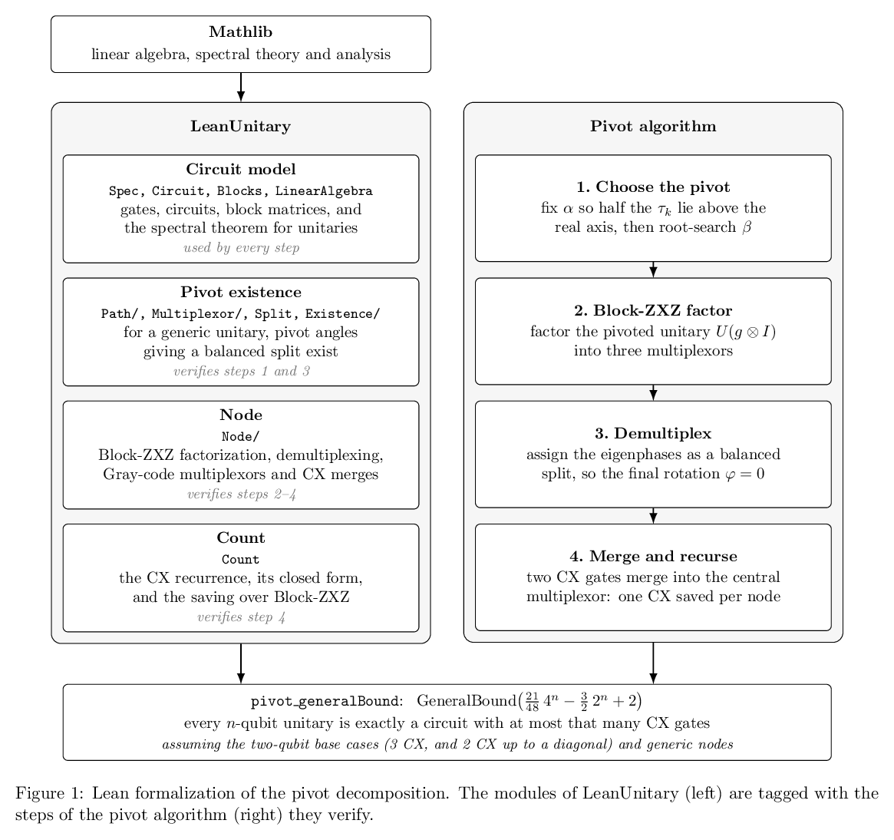

# LeanUnitary

The Lean 4 formalization of the pivot decomposition ([paper](../submission/)), built on
Mathlib. The circuit model is in `Spec.lean`; the pivot construction and the end-to-end CX bound
are proved in `Pivot/`. The library contains no `sorry`.



## Layout

| Path | Purpose |
| --- | --- |
| `../LeanUnitary.lean` | Library root; imports every module below |
| `Spec.lean` | Circuit model: gates, circuits, `Synthesizable n k`, `GeneralBound`, `R_y`, `R_z`, multiplexors |
| `Circuit.lean` | Circuit algebra: composition, lifting onto more qubits (`denote_lift`), CNOT counting |
| `Blocks.lean` | Bridge from bit-indexed operators to Mathlib's `Matrix.fromBlocks` (`blockDiag_eq`, `mux_last_eq`) |
| `LinearAlgebra.lean` | The spectral theorem for unitary matrices, by the Cayley transform |
| `Pivot/` | The pivot decomposition (below) |

## The pivot formalization, `Pivot/`

The modules are grouped by the steps of the algorithm, as in the diagram. All results are
stated for arbitrary finite index types (`m ⊕ m` blocks, as in `LeanUnitary.Blocks`), are fully
proved, and use only the standard axioms (`propext`, `Classical.choice`, `Quot.sound`).

| Module | Paper | Main results |
| --- | --- | --- |
| **Path** | | |
| `Path/Gate.lean` | Eq. (9) | `gate_mem_unitaryGroup` (the pivot `g = R_z(α)R_y(β)` is unitary); `fromBlocks_mul_lift` (Eq. 9 is the top row of `U(g⊗I)`); `Xg_zero`, `Yg_zero`, `Xg_pi`, `Yg_pi` (endpoint swap); `Xg_eq_mul`, `Yg_eq_mul` (factorization through `M = e^{iα}X⁻¹Y`) |
| `Path/Eigenvalues.lean` | Eq. (12) | `det_smul_add_smul_one` (`det(aM + b) = ∏(aτ_k + b)`); `roots_charpoly_inv`, `roots_charpoly_smul`; `norm_eq_one_of_mem_roots_charpoly`; `taus_eq_map` (`τ_k(α) = e^{iα}τ_k(0)`); `det_Xg_eq_prod`, `det_Yg_eq_prod` (Eq. 12); `ne_zero_of_mem_taus` |
| **Multiplexor** | | |
| `Multiplexor/Basic.lean` | Eqs. (10), (11) | `multiplexor` (`C(β)`, via the functional calculus); `multiplexor_pi` (`C(π) = C(0)ᴴ`); `invSqrt_mul_mem_unitaryGroup` (polar factors are unitary); `multiplexor_mem_unitaryGroup`; `multiplexor_pi_eq_inv` (`C(π) = C(0)⁻¹`) |
| `Multiplexor/Continuity.lean` | Sec. II.C | `continuousOn_invSqrt`; `isUnit_det_Xg`, `isUnit_det_Yg` (no real `τ_k` keeps `X_g`, `Y_g` invertible); `continuous_multiplexor` |
| `Multiplexor/Phase.lean` | Eqs. (12)–(14) | `sigma` (an explicit continuous phase of `det C(β)`); `continuousOn_sigma`; `exp_sigma` (`e^{iσ(β)} = det C(β)`); `sigma_zero`, `sigma_pi` (Eq. 13); `sigma_pi_eq_neg` (`σ(π) = −σ(0)` when `N₊ = N₋`) |
| **Split** | | |
| `Split.lean` | Eqs. (3), (6)–(8) | `walsh_eq` (φ depends only on the split and an integer `ℓ`); `exists_walsh_eq_zero_iff` (φ = 0 is attainable iff a balanced split exists); `topPlus`, `finalAngle` (the Walsh row and φ) |
| **Existence** | | |
| `Existence/Rotation.lean` | Eq. (13) | `exists_rotation_half_upper` (with distinct crossing angles, some rotation makes `N₊ = N₋` with no `τ_k` real), via `exists_eq_of_step_le_one` (a discrete intermediate value theorem) |
| `Existence/Lift.lean` | Eq. (15) | `normalized_lift_unique`; `neg_rev_eq_of_lift` (`ν(π) = −ν(0) ∘ rev`); `exists_normalized_lift`; `normalized_lift_stable` |
| `Existence/EigenContinuity.lean` | — | `eventually_exists_perm_close` (eigenvalues of a continuous matrix family move continuously, as matched lists); `norm_le_of_mem_roots_charpoly` |
| `Existence/PhaseList.lean` | Eq. (11) | `exists_phaseList`; `IsPhaseList.of_sameResidues`; `exists_int_of_exp_eq`; `multiplexor_phases_neg` (the phases of `C(π)` are those of `C(0)` negated); `exists_phase_close` |
| `Existence/Imbalance.lean` | Eqs. (16), (17) | `imbalance_neg_rev` (`P(π) = −P(0)`); `exists_imbalance_eq_zero` (a root `β*`); `exists_walsh_eq_zero_of_lift` (φ = 0 at `β*`) |
| `Existence/Pivot.lean` | Eqs. (1)–(3) | `continuousOn_lift` (the normalized lift with sum `σ(β)` is continuous); `exists_pivot_beta`; `exists_pivot` (both pivot angles exist); **`pivot_merge`** (for generic `U`, the pivot gives `U(g⊗I)` invertible top blocks and a Block-ZXZ multiplexor whose demultiplexing angles have `φ = 0`, so the extra CX merges) |
| **The node, as circuits** (`Node/`) | | |
| `Node/TopGates.lean` | Fig. 2 | `R_z`, Hadamard and `CX` onto the top qubit as multiplexors; `mux_mul` (they multiply per basis state); `denote_cxTop` |
| `Node/Gray.lean` | Eqs. (2), (3) | `grayMux_denote`, `grayMuxRev_denote` (the Gray-code multiplexed `R_z`, `2^n` CX); `core_split` (it ends `CX_0, R_z(φ), CX_{n-1}`); `firstAngle_eq` (`φ` is the mean of `θ⁻`) |
| `Node/Factor.lean` | Eq. (10) | **`exists_zxz_factor`**: `U = (A₁ ⊕ A₂)(H ⊗ I)(I ⊕ B)(H ⊗ I)(I ⊕ C)` with `C = zxzC X Y` (Krol–Al-Ars Sec. 4.1, proved) |
| `Node/Demux.lean` | Eqs. (1), (5), (6) | `demux` (demultiplexing, proved); `demux_of_phases` (any listing of the eigenphases of `C`, in any order and branch, is realized) |
| `Node/Glue.lean` | Fig. 2 | `denote_cxTop_eq` (`CX_c = (H⊗I)(I⊕Z_c)(H⊗I)`, the merge identity); `TopGates.comm_dup_diag` (diagonals pass through the multiplexors) |
| `Node/Factorize.lean` | Sec. II | `firstAngle_minus_eq_zero` (the paper's `φ = 0` is the last Gray-code angle); `middle_eq` (both CNOTs merge into `B`); **`node_factor`** (a generic node is `(V_a⊕V_a) R_a (V_b⊕V_b) M (W_b⊕W_b) R_c (W_c⊕W_c) (g⊗I)ᴴ` with `R_a`, `M`, `R_c` of `2^n-1`, `2^n`, `2^n-2` CX) |
| `Node/Synth.lean` | Eqs. (18), (19) | **`node_synth`** (children of `k` CX, `k-1` up to a diagonal, give `4k + 3·2^n - 6`); **`pivot_generalBound`** (the `(21/48) 4^n - (3/2) 2^n + 2` bound, end to end) |
| **Count** | | |
| `Count.lean` | Eqs. (18), (19) | `count_closed`, `count_eq` (`(21·4^n − 72·2^n + 96)/48`); `zxzCount_eq` (the Block-ZXZ count); `saving` (`Δ_n = (4^{n−2} − 1)/3`) |

**What is assumed.** The end-to-end theorem is `Node.pivot_generalBound`. Its only hypotheses are

* the two-qubit base cases: `Synthesizable 2 3` (Vatan–Williams) and
  `SynthesizableDiag 2 2` (two CX up to a diagonal; Shende–Bullock–Markov, quant-ph/0308045);
* the node bound for **non-generic** unitaries, i.e. when `Node.Generic` fails (see below).

Everything between is proved: the pivot angles (`pivot_merge`), the Block-ZXZ factorization
(`exists_zxz_factor`), demultiplexing with the pivot's eigenphase assignment
(`demux_of_phases`), the Gray-code multiplexors and their final angle (`Node/Gray.lean`), the two
CNOT merges into the central multiplexor (`middle_eq`), the diagonal bookkeeping of the children
(`node_synth`) and the count (`Count`). `pivot_generalBound` uses only the standard axioms.

**Genericity.** As in the paper, the pivot assumes a generic node (`Node.Generic`): `X`, `Y`
invertible and the eigenvalues of `X⁻¹Y` at distinct crossing angles. A bound for every unitary
also needs the non-generic nodes, either handled directly or by a perturbation argument; that case
is the remaining hypothesis of `pivot_generalBound`.

The kernel also evaluates `Pivot.count 10 = 457218` and `Pivot.zxzCount 10 = 479063`, the CX
counts the Python implementation in `submission/` measures on its synthesized circuits.

## Building

```sh
lake exe cache get   # download prebuilt Mathlib files (avoids a multi-hour compile)
lake build           # build the library
```

## Conventions

- **Dependencies:** `.lake/` is not committed. Run `lake exe cache get` before the first `lake build`; without the cache Lake compiles Mathlib from source, which takes hours.
- **Where code goes:** all definitions and theorems belong in modules under `LeanUnitary/`. `LeanUnitary.lean` holds only `import` lines.
- **Register new modules:** when you create `LeanUnitary/Foo.lean`, add `import LeanUnitary.Foo` to `LeanUnitary.lean`. `lake build` only compiles modules reachable from it.
- **Verify:** `lake build` must succeed after every change, with no `sorry`; check new results with `#print axioms`.
- **Don't change dependency pins:** leave `lean-toolchain`, `lake-manifest.json`, and the `rev`s in `lakefile.toml` alone, and don't run `lake update` (see [Dependencies](#dependencies)).

## Dependencies

The only dependency is Mathlib; the circuit model in `Spec.lean` is self-contained. The versions are
pinned:

- **Lean:** `v4.30.0-rc2` (`lean-toolchain`)
- **Mathlib:** commit `c1e30e17` (`lakefile.toml`)

To upgrade, set Mathlib's `rev` in `lakefile.toml` and `lean-toolchain` to a matching pair, then run
`lake update && lake build` and fix any breakage.
